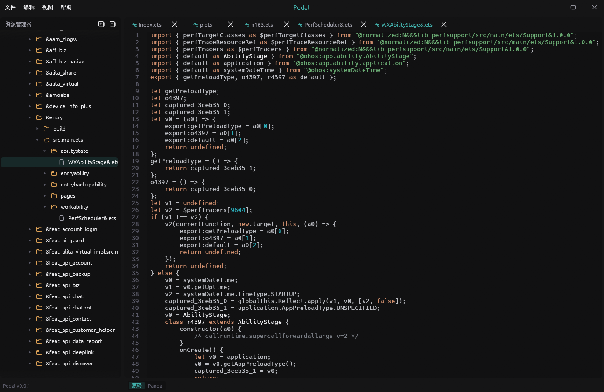

<div align="center">


# Pedal

**ArkTS decompiler**

Ark bytecode abc/pandasm disassembly powered by a pure-Rust engine [中文](README_CN.md)

[](https://www.rust-lang.org/)
[](https://github.com/emilk/egui)
[](#build)
[](LICENSE)</br>

</div>

## Credits

- [Pervius (Bkm016)](https://github.com/Bkm016/pervius) - this project started as a fork of it; its UI framework and application shell (egui-shell, the patched-egui workspace) are still in use
- [Vineflower](https://github.com/Vineflower/vineflower) - the Java decompiler that powered upstream Pervius, whose jadx-style workflow shaped this project's design


### ArkTS Decompilation

Open `.hap` / `.hsp` / `.har` / `.app` packages or Ark bytecode `.abc`, and Pedal decompiles every embedded ArkTS record to readable pseudo-ArkTS. Modern app bytecode and legacy system-framework layouts are supported.



## Command line

```bash
pedal analyze app.hap -o out
pedal analyze modules.abc --output out-abc
pedal analyze modules.abc -o out-limited --jobs 4
pedal --help
```

## Build

```bash
cargo build --release
cargo run --release
```

## License

[MIT](LICENSE)
