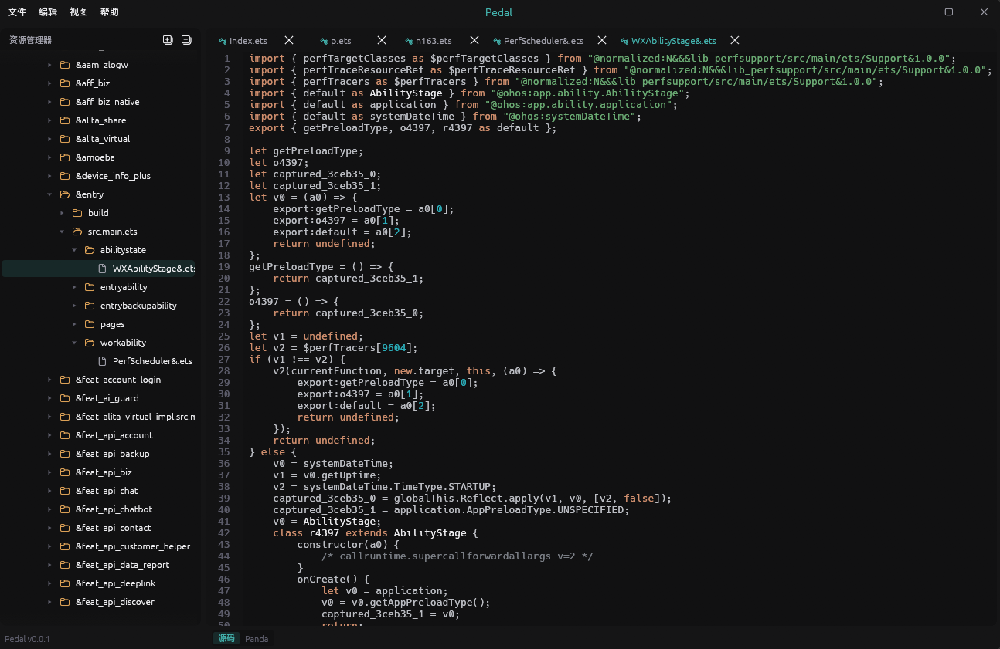

<div align="center">


# Pedal

**ArkTS 反编译器**

纯 Rust 引擎的方舟字节码 abc/pandasm 反汇编
 
[](https://www.rust-lang.org/)
[](https://github.com/emilk/egui)
[](#构建)
[](LICENSE)</br>

[特性](#特性) · [构建](#构建) · [English](README.md)

</div>

## 致谢

- [Pervius(Bkm016)](https://github.com/Bkm016/pervius) - 本项目由其 fork 而来，至今复用着它的 UI 框架与应用外壳(egui-shell、egui patch 工作区)
- [Vineflower](https://github.com/Vineflower/vineflower) - 上游 Pervius 所驱动的 Java 反编译引擎，其 jadx 风格交互奠定了本项目的设计


### ArkTS 反编译

直接打开应用包 `.hap` / `.hsp` / `.har` / `.app` 或方舟字节码 `.abc` Pedal 会把其中每个 ArkTS record 反编译为可读的伪 ArkTS。支持现代应用字节码与旧版系统框架布局。



## 命令行

```bash
pedal analyze app.hap -o out
pedal analyze modules.abc --output out-abc
pedal analyze modules.abc -o out-limited --jobs 4
pedal --help
```

## 构建

```bash
cargo build --release
cargo run --release
```

## 许可证

[MIT](LICENSE)
